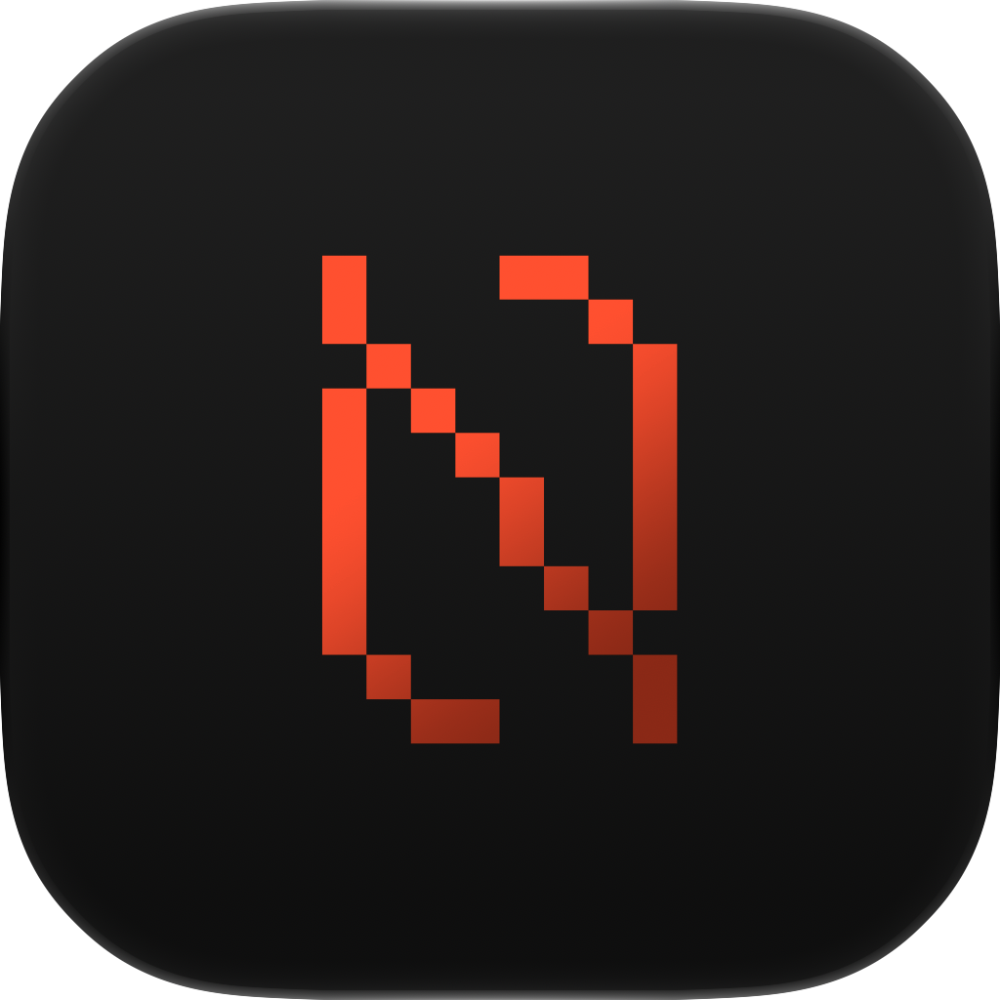

<div align="center">



# Notsky

### Liquid-Glass Spatial Notes and Local AI Workspace for macOS

<br />

[](https://apple.com/macos)
[](https://swift.org)
[](https://developer.apple.com/xcode/swiftui/)
[](https://github.com/romeet9/Notsky/releases/latest)
[](LICENSE)

<br />

<p align="center">
  Notsky transforms your macOS desktop into a tactile spatial canvas. It combines liquid-glass cards on a responsive multi-display grid, task lists and notes, a Groq-powered AI assistant and voice orb that manage your cards for you, plus Now Playing and Linear widgets.
</p>

<br />

</div>

https://github.com/user-attachments/assets/ba538de9-7584-4238-95df-bcfaf9edf732


---

## What is Notsky?

Notsky is an open-source native macOS desktop workspace application built entirely in Swift and SwiftUI. It replaces traditional static sticky notes with floating translucent cards featuring real-time wallpaper color sampling, multi-tab rich markdown editing, focus timers, an AI chat and voice assistant that can create and edit your cards, live music controls and your Linear issues.

### What's new in v1.0.10
- **Notsky AI**: a chat card powered by your own Groq API key. It finds files and folders, and creates, edits, pins and deletes cards, tasks and notes.
- **Voice**: an Apple Intelligence-style orb card. Hold `⌥Space` to add tasks and notes, create task groups or control music.
- **Now Playing**: a Control Center-style music card that also picks up browser audio, with HD album artwork.
- **Linear**: your assigned issues in To Do / In Progress / Done tabs, editable from the card.
- **Responsive grid**: cards stretch to fill each display and never overlap or run off-screen, with a separate grid on every monitor.
- **Remix Icon** throughout the app, a redesigned AI chat input and smoother shelf scrolling.

---

## Download and Quick Install

Pre-compiled releases are available for macOS Sonoma (14.0+) and macOS Sequoia (15.0+):

<div align="center">
  <br />
  <a href="https://github.com/romeet9/Notsky/releases/latest">
    
  </a>
  <br /><br />
</div>

1. Download **`Notsky-Next-macOS.dmg`** from the [Latest Release](https://github.com/romeet9/Notsky/releases/latest).
2. Open the DMG and drag **`Notsky Next.app`** to your `/Applications` directory.
3. The app isn't notarized, so the first time, right-click it and choose **Open**.
4. Allow microphone, speech recognition and automation access when macOS asks (used by Voice and Now Playing).

**API keys:** Notsky AI uses your own free [Groq](https://console.groq.com/keys) key and the Linear card uses a Linear personal API key. Add them in **Settings → AI** and **Settings → Linear**. Keys are stored only in your macOS Keychain, never on disk or in this repository.

---

## Core Capabilities

### Liquid-Glass Depth
Built using Apple native `.ultraThinMaterial` with specular light borders. Notsky samples your desktop wallpaper in real time to balance text contrast and dynamically tint badges, checkboxes, and timers.

### Spatial Multi-Card Canvas
Create task lists with spring-animated strike-throughs, multi-tab notes with bold and bullet formatting, and folders. Every display gets its own responsive grid: cells stretch to fill the screen, cards grow into empty neighbouring space, and new cards never overlap. When a screen is full, Notsky tells you instead of stacking cards off-screen.

### Notsky AI
A conversational chat card (`⌥⌘A`) backed by Groq tool calling. Ask it to *"add milk to my groceries list"*, *"pin the design card"* or *"find my resume PDF"*. It searches files with Spotlight, opens or reveals them, and manages every card. Destructive actions ask first and can be undone for 10 seconds.

### Voice
An animated orb card (`⌥⌘V`). Hold `⌥Space` and speak. Speech is transcribed on-device, then handled by Notsky AI (or a built-in command parser when no key is set). Voice and chat share one conversation.

### Now Playing
A music card (`⌥⌘M`) showing Apple Music, Spotify and browser audio, with play/pause, skip, a seek bar and high-resolution artwork.

### Linear
Your assigned Linear issues (`⌥⌘L`) in To Do / In Progress / Done tabs. Change status from the status circle, and priority, due date and more from the right-click menu.

### Slide-Up Notes Shelf
Press `⌥⌘D` from anywhere to slide up a full-width frosted glass shelf directly over the macOS Dock. Review all active project cards in a single horizontal carousel without moving open app windows.

### Tactile Feedback Engine
Mechanical synthetic audio clicks and macOS Taptic Engine haptics provide physical confirmation whenever you complete a task, switch tabs, or cycle wallpaper packs.

---

## Architecture

Notsky is a pure Swift Package Manager project. The only bundled third-party pieces are the [Remix Icon](https://remixicon.com) font (Apache-2.0) and [mediaremote-adapter](https://github.com/ungive/mediaremote-adapter) (BSD-3) for system-wide Now Playing.

```
Notsky/
├── Package.swift
├── Sources/NotskyApp/
│   ├── App/          # Lifecycle, menu bar, hotkeys
│   ├── Widgets/      # Desktop windows and the per-display responsive grid
│   ├── Notes/        # Task cards, NoteStore, card model
│   ├── Freeform/     # Multi-tab notes cards
│   ├── Folders/      # Folder cards
│   ├── AI/           # Groq client, Notsky agent and tools, file search
│   ├── Finder/       # Notsky AI chat card
│   ├── VoiceOpen/    # Voice orb card and speech
│   ├── NowPlaying/   # Music card, media adapter, HD artwork
│   ├── Linear/       # Linear GraphQL service and card
│   ├── Drawer/       # Slide-up notes shelf
│   ├── Settings/     # Settings window
│   ├── Wallpapers/   # Wallpaper packs and image handling
│   └── Support/      # Icons, motion, scaled fonts
└── Resources/        # Info.plist, entitlements, icons, Remix Icon, MediaRemoteAdapter, en.lproj
```

---

## Building from Source

### Prerequisites
* macOS 14.0 or newer
* Xcode 16+ or the Swift 6 Command Line Tools

```bash
# Clone the repository
git clone https://github.com/romeet9/Notsky.git
cd Notsky

# Compile release binary
# (Command Line Tools only? point at the macOS 26 SDK: SDKROOT=/Library/Developer/CommandLineTools/SDKs/MacOSX26.5.sdk)
swift build -c release

# Package the app
APP="/Applications/Notsky Next.app"
mkdir -p "$APP/Contents/MacOS" "$APP/Contents/Resources"
cp .build/release/NotskyApp "$APP/Contents/MacOS/Notsky"
cp Resources/Info.plist "$APP/Contents/Info.plist"
cp -R Resources/AppIcon.icns Resources/MenuBarIcon*.png Resources/Wallpapers \
      Resources/en.lproj Resources/RemixIcon Resources/MediaRemoteAdapter "$APP/Contents/Resources/"

# Sign (the entitlements enable Apple Events and the microphone)
codesign --force --sign - "$APP/Contents/Resources/MediaRemoteAdapter/MediaRemoteAdapter.framework"
codesign --force --sign - --options runtime --entitlements Resources/Notsky.entitlements "$APP"

open "$APP"
```

---

## Creator

Designed and built by **Romeet Chatterjee**

* **Portfolio**: [romeet-portfolio.vercel.app](https://romeet-portfolio.vercel.app)
* **GitHub**: [@romeet9](https://github.com/romeet9)
* **Twitter / X**: [@romeetchatterjee](https://x.com/romeetchatterjee)

---

<div align="center">
  <sub>© 2026 Romeet Chatterjee. All rights reserved. Source-available for personal evaluation. Commercial redistribution, reselling, or unauthorized republishing is strictly prohibited.</sub>
</div>